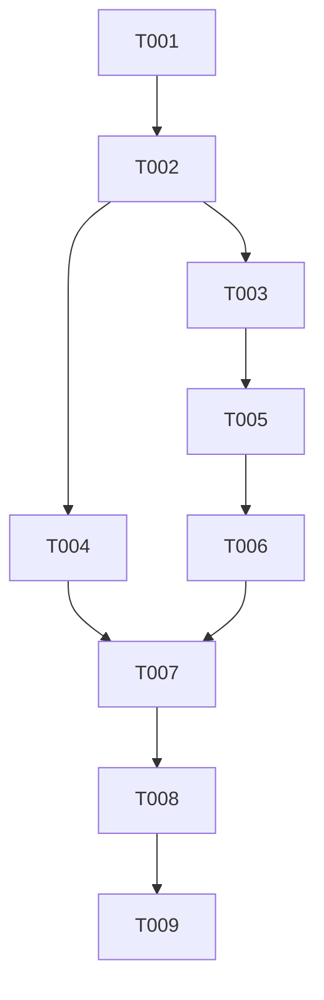

# Tasks: Correct Active Workflow Run Timing

**Input**: [plan.md](plan.md), [spec.md](spec.md), [research.md](research.md),
[data-model.md](data-model.md), and [contracts/ui-api.md](contracts/ui-api.md).

**Approval**: Task generation, [Issue #74](https://github.com/repovio/repovio/issues/74), and the planning-only commit/push
are approved on 2026-11-09. Implementation and merge remain separate decisions. All tasks below are unstarted.

**Branch**: `codex/74-fix-active-run-timing`.

**Organization**: US1 is the active-run MVP; US2 preserves valid terminal timing and completes edge-case acceptance.
Regression tests are required by the approved plan and repository instructions. Each implementation task includes
its own tests, documentation, validation, graph update, and focused `repovio` patch Changeset.

## Format and Delivery Rules

- `[P]` means independent files and no dependency on the other parallel task; it does not authorize agent delegation.
- `[US1]` and `[US2]` map to the specification's user stories.
- Before every edit, test, and commit, inspect status and relevant diffs; preserve unrelated work.
- Once implementation is separately approved, commit each completed substantive task separately with exactly one
  focused Changeset, then push under repository policy. Do not commit failing tests alone.
- Keep tests and implementation together within each task; establish the regression before its fix where applicable.
- Read-only setup and final verification require no empty commit or fabricated Changeset.
- Preserve provider read-only behavior, CASL restrictions, DTO field selection, locale text, and toolchain pins.
- No schema migration, production repair, new timer, or external provider mutation is included.

## Phase 1: Setup

**Purpose**: Verify task context and prepare the already selected worktree without changing product behavior.

- [ ] T001 Verify `specs/005-fix-active-run-timing/{spec,plan,tasks}.md` and `.specify/feature.json` resolve this feature; record the authorized issue and planning commit before implementation, preserve the existing Codex worktree, and prepare Node.js 26.13.0/Corepack pnpm 11.28.9 with locked dependencies from `package.json` and `pnpm-lock.yaml`.

**Acceptance**: Correct issue/spec/task association, reviewed planning commit, and runnable pinned workspace. This task
cannot bypass missing issue/planning-commit or implementation approval.

## Phase 2: Foundational Verification

**Purpose**: Establish the baseline and identify timing boundaries used by both stories.

- [ ] T002 Review `apps/api/src/modules/providers/forgejo/forgejo-actions.adapter.ts`, `apps/api/src/modules/providers/sync.service.ts`, `apps/api/src/modules/repositories/dto/resource.dto.ts`, `apps/api/src/modules/dashboard/dto/dashboard-workflow-run.dto.ts`, and `apps/web/app/components/modules/{workflow-runs/table-page,dashboard/latest-runs}.vue`; run their existing focused tests and record preexisting failures in `specs/005-fix-active-run-timing/evidence.md` without changing implementation.

**Acceptance**: Record current approval-waiting duration assertion, provider list/detail/webhook paths, API projection
paths including repository-scoped reads, existing test commands, and baseline outcomes. Query Graphify before new
source exploration. No new infrastructure or runtime contract is required.

## Phase 3: User Story 1 - Recognize Unfinished Runs (Priority: P1, MVP)

**Goal**: Active runs expose no final timing, including bad stored rows and stale browser payloads.

**Independent Test**: Seed QUEUED/RUNNING rows with absent, epoch, negative, and plausible stale timing; verify API
responses and both run-row surfaces show existing unavailable labels before synchronization and after synchronization.

- [ ] T003 [P] [US1] Correct Forgejo timing normalization in `apps/api/src/modules/providers/forgejo/forgejo-actions.adapter.ts` with regression cases in `apps/api/src/modules/providers/forgejo/forgejo-actions.adapter.spec.ts`: normalize status first; enforce `completedAt` constraint "Null for QUEUED/RUNNING; otherwise valid nonsentinel timestamp" and `startedAt` constraint "Retain valid input; reject malformed or provider-sentinel start values"; suppress active final duration, intentionally replace the queued approval fixture's 3,000 ms expectation with null, retain approval/status metadata, and preserve valid terminal behavior; add `.changeset/fix-forgejo-active-run-timing.md`.
- [ ] T004 [P] [US1] Add shared run-aware presentation validation in `apps/web/app/utils/workflow-run-timing.ts` and focused tests in `apps/web/app/utils/workflow-run-timing.spec.ts`; integrate `apps/web/app/components/modules/workflow-runs/table-page.vue` and `apps/web/app/components/modules/dashboard/latest-runs.vue`, and add `apps/web/tests/e2e/workflow-run-timing.spec.ts` for both surfaces in English/German using queued/running and stale cached fixtures; enforce duration constraint "Null for active runs; otherwise finite and nonnegative", reuse existing unavailable labels and valid formatting, leave the generic date formatter unchanged, and add `.changeset/fix-active-run-timing-display.md`.
- [ ] T005 [US1] Enforce null active final timing at persistence in `apps/api/src/modules/providers/sync.service.ts`, with regression tests in `apps/api/src/modules/providers/sync.service.spec.ts` covering list/detail reconciliation and webhook-triggered sync entry paths; prove bad existing active timing is overwritten by explicit null assignments and preserve run identity constraint "Unchanged; synchronization updates the same row"; add `.changeset/fix-active-run-timing-persistence.md`.
- [ ] T006 [US1] Normalize existing stored active rows in `apps/api/src/modules/repositories/dto/resource.dto.ts` and `apps/api/src/modules/dashboard/dto/dashboard-workflow-run.dto.ts`; add focused DTO coverage in `apps/api/src/modules/repositories/dto/resource.dto.spec.ts` and `apps/api/src/modules/dashboard/dto/dashboard-workflow-run.dto.spec.ts`, extend selected-field/repository-scoped assertions in `apps/api/src/modules/workflow-runs/workflow-runs.controller.spec.ts` and `apps/api/src/modules/workflow-runs/authorization.integration.spec.ts`, retain ability-aware filtering and existing query semantics, and add `.changeset/fix-active-run-timing-responses.md`.

**Task-specific validation**:

- T003: Focused Forgejo Jest suite; valid terminal controls pass alongside active null assertions.
- T004: Focused Vitest and Playwright timing scenarios, web lint/typecheck, English/German screenshots. Assert exact
  unavailable values so a missing row cannot falsely pass a negative-date check.
- T005: Focused sync Jest suite proves list/detail entry paths and idempotent updates; no extra provider calls.
- T006: DTO/controller/authorization suites prove active null fields before any sync, omitted-field behavior, and no
  unauthorized repository disclosure. Internally needed status must not leak when excluded by field selection.

**Checkpoint**: US1 is independently usable. Valid terminal control fixtures must already pass; US2 expands edge cases
rather than permitting this MVP to regress valid history.

## Phase 4: User Story 2 - Preserve Valid Completed Timing (Priority: P2)

**Goal**: Completion transitions and timing edge cases preserve useful terminal history while rejecting bogus values.

**Independent Test**: Transition one stored active run to terminal state and verify identity, valid completion,
zero-duration display, and independent valid timing survive normalization, serialization, and rendering.

- [ ] T007 [US2] Complete terminal timing validation in `apps/api/src/modules/providers/forgejo/forgejo-actions.adapter.ts` and the DTO timing boundaries introduced by T006; extend `apps/api/src/modules/providers/forgejo/forgejo-actions.adapter.spec.ts`, `apps/api/src/modules/providers/sync.service.spec.ts`, `apps/api/src/modules/repositories/dto/resource.dto.spec.ts`, and `apps/api/src/modules/dashboard/dto/dashboard-workflow-run.dto.spec.ts` for SUCCESS/FAILED/CANCELLED/SKIPPED/UNKNOWN, invalid or epoch completion, pre-start completion, valid missing-start fallback, negative/nonfinite duration, nanosecond conversion, zero duration, active-to-terminal and return-to-active transitions; preserve "Existing provider normalization remains authoritative" and "Zero milliseconds remains valid"; add parity fixtures to existing GitHub/GitLab/Gitea adapter tests, changing their mappings only if the approved invariant fails, and add `.changeset/fix-terminal-run-timing-validation.md`.
- [ ] T008 [US2] Extend `apps/web/app/utils/workflow-run-timing.spec.ts` and `apps/web/tests/e2e/workflow-run-timing.spec.ts` with valid terminal timestamps, zero duration, invalid completion with independently valid duration, negative duration with independently valid completion, UNKNOWN, and an active-to-terminal refresh in both locales; adjust `apps/web/app/utils/workflow-run-timing.ts` only for uncovered contract failures, retain each surface's existing rounding/date preferences, record screenshots and results in `specs/005-fix-active-run-timing/evidence.md`, and add `.changeset/verify-terminal-run-timing-display.md`.

**Acceptance**: Valid terminal values, including zero, remain visible; invalid independent fields remain unavailable;
no duplicate run is created during transitions. No new status, schema field, or elapsed-duration feature appears.

## Phase 5: Cross-Cutting Verification

- [ ] T009 Validate the complete matrix in `specs/005-fix-active-run-timing/quickstart.md`; run affected API/web tests, lint, typecheck, documentation coverage, canonical formatting twice, `git diff --check`, and browser checks; verify `graphify-out/graph.json` matches source changes and record results, screenshot paths, task commit SHAs, and any unverified live-provider behavior in `specs/005-fix-active-run-timing/evidence.md`.

**Acceptance**: All seven functional requirements and four success criteria have evidence. Disclose unrelated baseline
failures; do not weaken checks. No release, deployment, bulk repair, or merge follows from task-generation approval.
If verification finds a scoped defect, fix it in a separately validated substantive commit with its own Changeset.

## Dependencies and Execution Order

- Setup and baseline block all implementation.
- US1 completes after T003, T004, T005, and T006; T005 depends on T003, and T006 follows T005.
- US2 depends on the US1 timing boundaries; its terminal-transition tests are independently executable using fixtures.
- T009 follows both stories. Normal execution remains sequential in task-ID order unless parallel work is explicitly chosen.

## Parallel Examples

### User Story 1

After T002, T003 provider work and T004 presentation work touch independent files and can proceed in parallel.
Keep separate commits, Changesets and test evidence. Do not edit shared schema or status definitions in either task.

### User Story 2

After T006, terminal provider fixture preparation in T007 and browser fixture preparation for T008 can be reviewed
independently. T008 execution remains dependent on T007; neither task is marked `[P]`. Focused provider and web test
commands may run concurrently once their inputs are complete. No agent delegation is implicitly authorized.

## Implementation Strategy

1. Obtain separate issue/planning-commit and implementation approvals; complete setup and baseline verification.
2. Deliver US1 as the MVP with normalized provider input, safe persistence, immediate read projection, and safe rendering.
3. Complete US2 terminal edge cases and transition evidence without expanding into historical data repair.
4. Run cross-cutting acceptance and synchronize approved issue/task status only after checks and task commits pass.

## Coverage Map

| Requirement | Tasks                  | Evidence                                                          |
| ----------- | ---------------------- | ----------------------------------------------------------------- |
| FR-001      | T003–T006              | Active provider, persistence, API and UI assertions               |
| FR-002      | T003, T004, T007, T008 | Sentinel, invalid, reversed, negative and nonfinite timing cases  |
| FR-003      | T003, T007, T008       | Valid terminal values, zero and independent fallback assertions   |
| FR-004      | T004, T006             | Stored active row before synchronization and stale cached payload |
| FR-005      | T005, T007             | Explicit null overwrite, terminal refresh and stable identity     |
| FR-006      | T004, T008             | Dashboard/table screenshots and assertions in English/German      |
| FR-007      | T003, T005, T006, T009 | Approval metadata, read-only calls and repository authorization   |

**Counts**: 9 tasks total; setup/foundational 2, US1 4, US2 2, cross-cutting verification 1.
